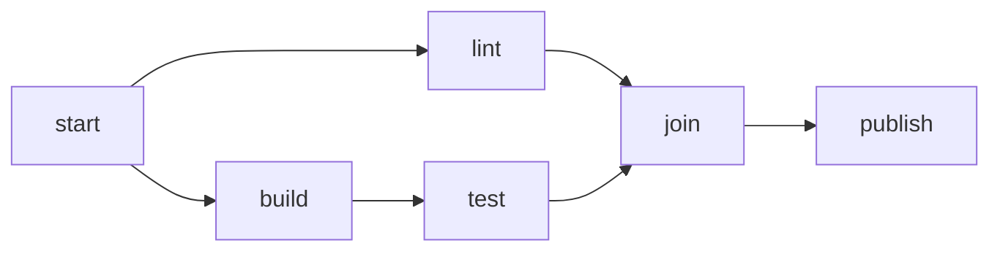

<!-- graph authoring skeleton (spec-objects-business). Contract:
     - Frontmatter MUST carry id, title, type: graph, object: graph.
     - "## Graph" (H2, required): one `mermaid` fence holding a `flowchart`
       or `graph` diagram. Nodes are the graph's elements; an edge `A --> B`
       says A must complete before B starts. Nodes with no path between them
       are unordered and may run concurrently. The graph SHALL be acyclic.
     Use a state_machine when the thing has one current state and moves
     between states; use a graph when it is a partial order with no current
     state. A graph declares no states, transitions, fields or operations. -->
# [graph_001] CausalControlGraph

The causal control graph orders the steps of a run. Steps on separate
branches are unordered; a join waits for every branch that feeds it: `join` completes only when both
`lint` and `test` have completed.

## Graph

